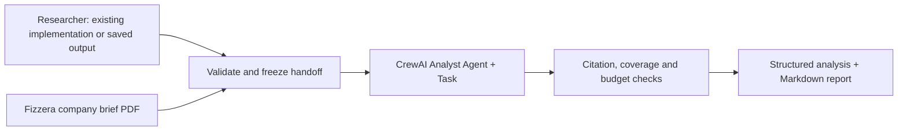

# Fizzera Researcher → Analyst collaboration

The independent downstream Reviewer is now available. See
[REVIEWER_README.md](REVIEWER_README.md) to review an existing Analyst run or add
`--review` to the command below. Review is optional; automatic correction is off.
Use `--executive` to include review followed by the final [executive brief agent](EXECUTIVE_README.md).

CrewAI controls the sequence:



The Researcher remains company-neutral and unchanged. A CrewAI **Flow** schedules
the existing Researcher stage, the handoff, and the downstream native CrewAI
Analyst **Agent/Task**. This preserves the Researcher you approved while using
CrewAI to manage collaboration. It does not replace the Researcher with a second
prompt or rerun it when you supply a saved output.

## Run from the repository root

Keep `OPENAI_API_KEY` in the local `.env`. Optional `ANALYST_MODEL` defaults to
`gpt-4o-mini`; `RESEARCHER_MODEL` still controls fresh Researcher calls. Install
Poppler for PDF text extraction (`brew install poppler` on macOS).

Reuse the approved five-article Researcher output:

```bash
uv run --cache-dir .cache/uv --with-requirements requirements-analyst.txt python scripts/run_fizzera_analyst.py \
  --brief "/path/to/Fizzera Sodas.pdf" \
  --research-output .researcher/evidence_pack_expanded.json \
  --output-dir .researcher/fizzera_runs/my_run
```

Or run the existing Researcher first, then the Analyst:

```bash
uv run --cache-dir .cache/uv --with-requirements requirements-analyst.txt python scripts/run_fizzera_analyst.py \
  --brief "/path/to/Fizzera Sodas.pdf" \
  --articles .researcher/articles_rechecked.json \
  --output-dir .researcher/fizzera_runs/fresh_run
```

`--as-of YYYY-MM-DD` pins the analysis date; otherwise Toronto's current date is
used. Choose a new output directory each time. Omitting both source options reuses
`.researcher/evidence_pack_expanded.json`. Both modes make a paid Analyst call;
`--articles` also makes a paid Researcher call. No quality judges are called.
Full frozen article text and the full company brief are sent to the configured
model as the Analyst's context.

## What the Analyst receives

- The Researcher's exact research question, findings and source registry.
- **Every saved source paragraph**, including context beyond the short summaries.
- All 18 pages of the company brief, with `[BRIEF pN]` references.
- An explicit analysis date and provenance notes separating market evidence from
  company-supplied assumptions, fictional survey figures, forecasts and targets.

The handoff validates source hashes, finding IDs, dates and paragraph references
before the Analyst can run. Company-specific context is added only after the
Researcher stage, preserving neutral evidence collection.

The uploaded PDF ends with an incomplete question on page 18. That limitation is
recorded rather than completed by inference. The budget ceilings extracted from
this brief are CAD 1.2 million total discretionary investment and CAD 250,000 for
product development/launch preparation. Proposals needing additional financing
must be explicitly labeled as such.

## What it produces

| Artifact in the output directory | Purpose |
| --- | --- |
| `analyst_report.md` | Readable competitive intelligence tailored to Fizzera |
| `analyst_report.json` | Structured observations, interpretations, competitors and decisions |
| `researcher_output.json` | Frozen upstream output used in this run |
| `company_brief.json` | Extracted PDF pages, hashes, data labels and monetary ceilings |
| `handoff.json` / `handoff.txt` | Exact evidence and company context given to the Analyst |
| `run_manifest.json` | Source mode, hashes, dates, token usage, latency and MLflow trace ID |
| `analyst_raw.txt` | Model output preserved before final validation |

Observations cite Researcher finding IDs or article paragraph IDs. The Markdown
renderer resolves them to publisher links and dates. Fizzera-specific implications
and recommendations cite the relevant brief pages separately. Strategic
interpretations are explicitly distinguished from reported facts.
Consumer tests grounded only in the company brief are labeled separately from
competitive-evidence-backed strategic recommendations; they do not approve a launch.

The Analyst addresses Ontario retail, pricing, the single 2027 product decision,
marketing, and conditional BC expansion. It covers Olipop, Poppi, Culture Pop,
Zevia, Cove Soda and Crazy D's, marking evidence gaps where the five-article
sample has no coverage. A company being named in the brief does not count as
competitive evidence.

The Analyst has no browsing/delegation tools, persistent agent memory, automatic
context compression or Writer model call. The optional Reviewer is a separate
CrewAI stage after analysis. Markdown rendering happens
in code. CrewAI transport/error retries are disabled and the agent's reasoning
loop is bounded; an invalid result fails rather than launching an open-ended
correction process. Provider/framework internals may still make additional calls
for structured conversion; recorded usage is the source of truth.

Company data and generated reports stay under ignored `.researcher/` by default.
CrewAI's local SQLite state also stays there. Cloud tracing and anonymous CrewAI
telemetry are disabled; existing MLflow configuration is respected, with local
MLflow as the default.

The working local sample is `.researcher/fizzera_runs/pilot_v2/analyst_report.md`.
It uses the approved five-article Researcher output and the supplied Fizzera PDF.
The smoke test completed with a persisted MLflow trace; no independent quality
evaluation was performed. The earlier `pilot` directory preserves a draft that
stopped at a validation check and is not the final sample.

## Functional checks

```bash
uv run --cache-dir .cache/uv --with-requirements requirements-analyst.txt python -m unittest analyst.test_workflow researcher.test_agent crew_ai.test_data
```

Tests exercise real CrewAI Flow sequencing with mocked model output, fresh/reused
Researcher routing, full-text handoff, references, budget ceilings and explicit
coverage gaps. These are software checks, **not** a quality evaluation or proof
that an interpretation is sound. Review the sample output yourself before using
its recommendations. The Reviewer implementation and checks are documented separately.

## Revising after Reviewer feedback

The optional [correction workflow](REVISION_README.md) gives the Analyst its original
draft, selected Reviewer issues, full original evidence and company brief. It preserves
all versions and runs one independent recheck after the revision.
